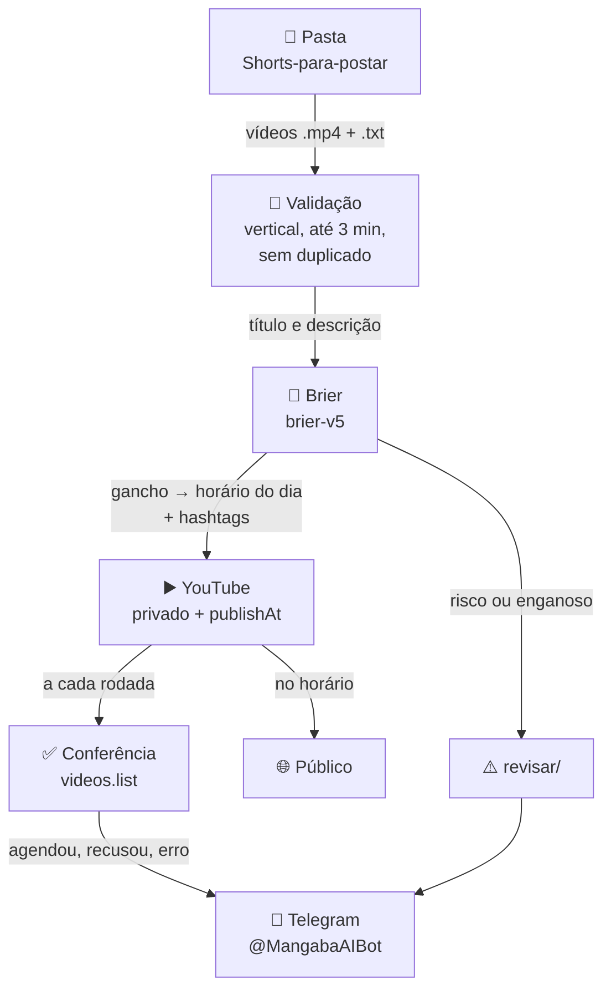

# Agendador de Shorts
{: .fs-9 }

Coloque os vídeos numa pasta. O agente agenda **14 Shorts por dia** no YouTube, de hora em hora entre 07:00 e 20:00, o **Brier** decide o horário de cada um dentro do dia, segura o que precisa de revisão e escolhe as hashtags, e você recebe os avisos no Telegram.
{: .fs-6 .fw-300 }

[Configurar em 4 passos](configuracao){: .btn .btn-primary .mr-2 }
[Ver o código](https://github.com/dheiver2/shorts-agendador){: .btn }

---

## Como funciona

1. **A cada 2 horas** o Mac roda o agente (launchd). Se o Mac estiver dormindo, ele roda quando o Mac acordar.
2. O agente pega os vídeos da pasta **em ordem alfabética** e preenche os horários vagos de hoje e de amanhã.
3. Cada vídeo sobe **privado, com a hora de publicação marcada**. No horário, o próprio YouTube deixa o vídeo **público**. O Mac não precisa estar ligado nessa hora.
4. Vídeos enviados vão para `postados/`. Formato errado vai para `rejeitados/` e risco apontado pelo Brier vai para `revisar/`.

## A semana

| | seg | ter | qua | qui | sex | sáb | dom |
|---|:-:|:-:|:-:|:-:|:-:|:-:|:-:|
| Posts | 14 | 14 | 14 | 14 | 14 | 14 | 14 |

Um vídeo por hora, das **07:00 às 20:00** (horário de Brasília), 98 por semana. Dentro de cada dia, o vídeo de gancho mais forte fica com o melhor horário, nesta ordem: 12:00, 19:00, 20:00, 18:00, 17:00, 13:00, 11:00, 14:00, 16:00, 10:00, 15:00, 09:00, 08:00, 07:00. Se a cota diária da API acabar, os melhores horários são enviados primeiro e o agente para de tentar até a cota zerar (05:00, meia-noite no Pacífico). [Como o Brier decide](brier).

## Situação validada

Medido ao vivo em 08/11/2026:

| Item | Resultado |
|---|---|
| Agendamentos íntegros no YouTube | 10 de 10 (privados, com a hora certa) |
| Formato Shorts | 1080×1920, de 55 a 60 s |
| Testes automáticos | 30 de 30 |
| Rodada automática com Brier e aviso | feita em 08/11 às 07:14 |
| Reposição de horário perdido | 1 de 1 (07/11 21:00 → 08/11 15:00) |
| **Nota validada** | **80 de 100**: faltam a publicação no horário (15) e a comparação do Brier com as views (5) |
